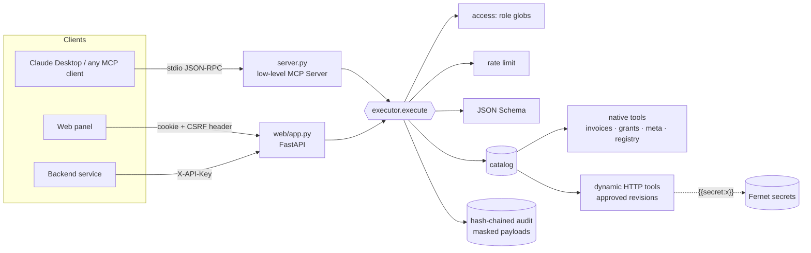

<div align="center">

# toolgate · mcp-tool-gateway

**One governed MCP server in front of many tool domains.**
Per-tool RBAC · encrypted secrets · four-eyes dynamic tools · tamper-evident audit trail.


[English](#english) · [Português](#português)


</div>

---

## English

### Why this exists

Giving an LLM tools is easy. Giving it tools **safely, across teams, with an
answer to "who called what, with which data, and was it allowed?"** is the
actual job. This repository is that layer: a single MCP server that every
client connects to, where every call — from Claude Desktop, from the web panel
or from another backend — passes through the same door.

> All data is synthetic and generated from fixed seeds. No API keys are needed
> to run anything here, and none are in the repository.

### What it demonstrates

| Capability | How |
|---|---|
| **MCP server with data-driven tools** | Low-level `mcp.server.lowlevel.Server`: tools and their JSON Schemas come from the catalog at request time, so a tool approved in the panel appears on the client's next `tools/list` — no restart. |
| **One executor for every door** | `resolve → authorize → rate-limit → validate → run → audit`, shared by stdio MCP, panel and service API ([ADR 0001](docs/adr/0001-one-executor-for-every-door.md)). |
| **Per-tool RBAC** | Roles are data: fnmatch globs over tool names + a closed set of admin permissions. Clients only *see* tools they can call ([ADR 0003](docs/adr/0003-roles-as-data.md)). |
| **Governed dynamic tools** | HTTP endpoints registered as JSON, validated (schema, https, no private IPs, no literal credentials), approved by a *different* person ([ADR 0004](docs/adr/0004-dynamic-tools-with-four-eyes.md)). |
| **Secrets done right** | Fernet at rest, `{{secret:name}}` references, resolved per caller at call time, never shown back. |
| **Tamper-evident audit** | SHA-256 hash chain over masked events; the panel verifies it live ([ADR 0005](docs/adr/0005-hash-chained-audit.md)). |
| **PII masking** | CPF/CNPJ/e-mail/phone/card/tokens masked *before* storage, keeping enough suffix for support. |
| **Chat over governed tools** | `/api/chat` routes a PT/EN message to a tool, extracts arguments, asks follow-ups for what is missing, keeps context (“and in GO?”), executes through the same executor (RBAC + audit) and explains the result. Offline by default; `GATEWAY_LLM_API_KEY` switches to OpenAI-compatible tool calling over the same tools. |
| **Stored conversations** | Every chat is saved per user (SQLite), with its tool calls, results and correlation ids; reopen, rename or delete from the sidebar, and answer a pending follow-up days later. Owner-scoped: another user's conversation id answers 404. |
| **Deterministic intent baseline** | `meta.suggest_tool` ranks tools for a PT/EN request with reasons — the floor LLM routers are benchmarked against in [`llm-routing-eval-lab`](https://github.com/murilo-bassan/llm-routing-eval-lab) ([ADR 0006](docs/adr/0006-deterministic-intent-baseline.md)). |
| **Production hygiene** | CSRF guard, strict CSP, scrypt, rate limiting, non-root Docker image with healthcheck, CI matrix + container smoke test. |

### Architecture



### Quick start

```bash
git clone https://github.com/murilo-bassan/mcp-tool-gateway.git
cd mcp-tool-gateway
pip install -r requirements-dev.txt

python -m pytest                      # 101 tests, ~20 s, includes a real stdio MCP round-trip
python scripts/demo_traffic.py        # optional: fill the panel with activity
python -m uvicorn web.app:app --port 8600   # panel → http://localhost:8600 (admin/admin)
```

Talk MCP to it from the terminal, through the real protocol:

```bash
python scripts/mcp_call.py list
python scripts/mcp_call.py call invoices.validate_tax_id '{"tax_id": "11.222.333/0001-81"}'
python scripts/mcp_call.py suggest "which agreements are overdue in MS?"
```

Or plug it into Claude Desktop with [`docs/claude_desktop_config.example.json`](docs/claude_desktop_config.example.json).
Docker: `docker compose up --build`.

### Tool domains (synthetic)

| Domain | Tools | Notes |
|---|---|---|
| `invoices.*` | `validate_tax_id`, `search`, `get`, `compute_withholding` | Real CPF/CNPJ check-digit algorithms; illustrative (not legal) withholding table with a line-by-line explanation. |
| `grants.*` | `search_agreements`, `get_agreement`, `summary_by_state`, `flag_risks` | 240 synthetic public-transfer agreements; deterministic risk rules. |
| `meta.*` | `whoami`, `list_tools`, `suggest_tool` | Discovery, filtered by role. |
| `registry.*` | `list`, `propose`, `review` | The governance flow, available over MCP too. |

### Screens

| Console | Audit trail |
|---|---|
|  |  |
| **Registry** | **Access** |
|  |  |

### Layout

```
gateway/
  config.py        settings from env, swappable in tests
  store.py         SQLite (WAL), schema, transactions
  access.py        principals, roles, sessions, API keys, scrypt
  secrets_store.py Fernet secrets + {{secret:x}} rendering
  catalog.py       ToolSpec, @native, lookup (native + dynamic)
  registry.py      dynamic tool lifecycle, validation, HTTP execution
  executor.py      the single door
  audit.py         hash chain, search, stats
  masking.py       PII/credential masking
  intents.py       deterministic tool suggestion
  ratelimit.py     sliding window
  domains/         invoices, grants, meta, governance, synthetic data
server.py          stdio MCP server
web/               FastAPI panel + vanilla JS UI (VOID theme)
scripts/           mcp_call.py (MCP client), demo_traffic.py
docs/              ADRs, security model, screenshots
```

See [`docs/security.md`](docs/security.md) for the threat model and what is deliberately out of scope.

---

## Português

### Por que existe

Dar tools a um LLM é fácil. Difícil é dar **com segurança, entre equipes, e
conseguir responder "quem chamou o quê, com quais dados, e era permitido?"**.
Este repositório é essa camada: um único servidor MCP ao qual todo cliente se
conecta, onde toda chamada — do Claude Desktop, do painel web ou de outro
backend — passa pela mesma porta.

> Todos os dados são sintéticos, gerados com sementes fixas. Nada aqui precisa
> de chave de API, e nenhuma chave está no repositório.

### O que demonstra

- **Servidor MCP com tools vindas de dados**: os JSON Schemas saem do catálogo a cada `tools/list`; uma tool aprovada no painel aparece no cliente sem reiniciar nada.
- **Um executor para todas as portas**: resolver → autorizar → limitar taxa → validar → executar → auditar, igual para MCP, painel e API de serviço.
- **Permissão por tool**: papéis são dados (globs sobre nomes de tools + permissões administrativas fechadas). O cliente só *vê* o que pode chamar.
- **Tools dinâmicas governadas**: endpoints HTTP cadastrados como JSON, validados (schema, https, sem IP privado, sem credencial literal) e aprovados por **outra** pessoa.
- **Secrets**: criptografados com Fernet, referenciados como `{{secret:nome}}`, resolvidos por quem chama, nunca exibidos de volta.
- **Auditoria à prova de adulteração**: cadeia de hashes SHA-256 sobre eventos já mascarados; o painel verifica ao vivo.
- **Mascaramento de dados pessoais**: CPF, CNPJ, e-mail, telefone, cartão e tokens mascarados antes de gravar.
- **Chat sobre as tools governadas**: pergunta em PT ou EN, escolhe a tool, extrai os argumentos, pergunta o que falta e executa pelo mesmo executor (permissão + auditoria). Interface com opção PT-BR/EN.
- **Conversas armazenadas**: cada conversa fica salva por usuário, com as chamadas, resultados e ids de correlação; dá para voltar, renomear ou excluir, e responder uma pergunta pendente depois. Só o dono enxerga.
- **Baseline determinístico de intenção**: `meta.suggest_tool` sugere a tool com as razões — é o piso contra o qual os roteadores com LLM são comparados no [`llm-routing-eval-lab`](https://github.com/murilo-bassan/llm-routing-eval-lab).

### Como rodar

```bash
pip install -r requirements-dev.txt
python -m pytest                              # 101 testes, inclui ida e volta MCP real via stdio
python scripts/demo_traffic.py                # opcional: gera atividade para o painel
python -m uvicorn web.app:app --port 8600     # painel em http://localhost:8600 (admin/admin)
python scripts/mcp_call.py suggest "quais convênios estão atrasados em MS?"
```

Decisões de arquitetura em [`docs/adr/`](docs/adr) e modelo de ameaças em [`docs/security.md`](docs/security.md).

---

<sub>Part of an AI engineering portfolio — see [ai-engineering-portfolio](https://github.com/murilo-bassan/ai-engineering-portfolio). MIT licensed.</sub>
