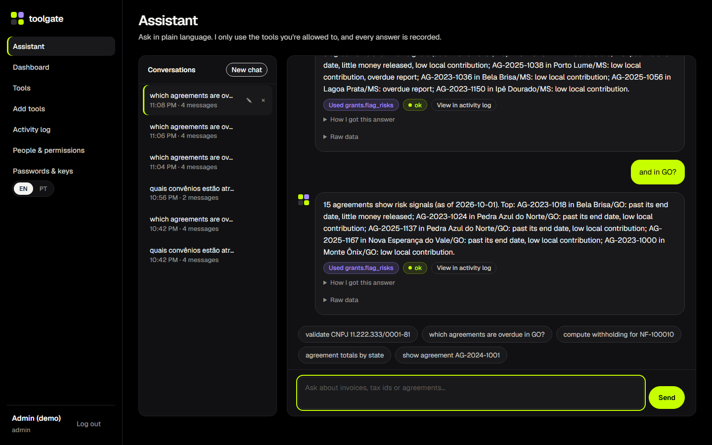
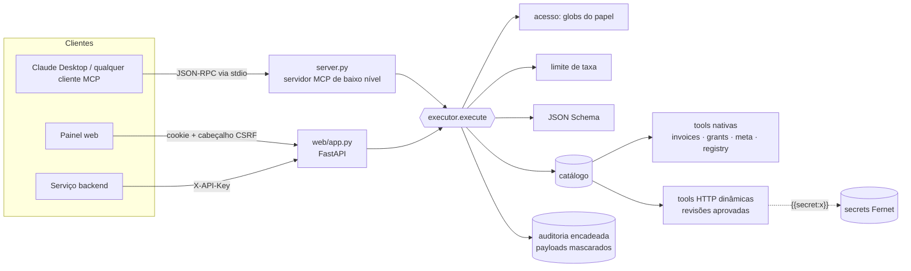
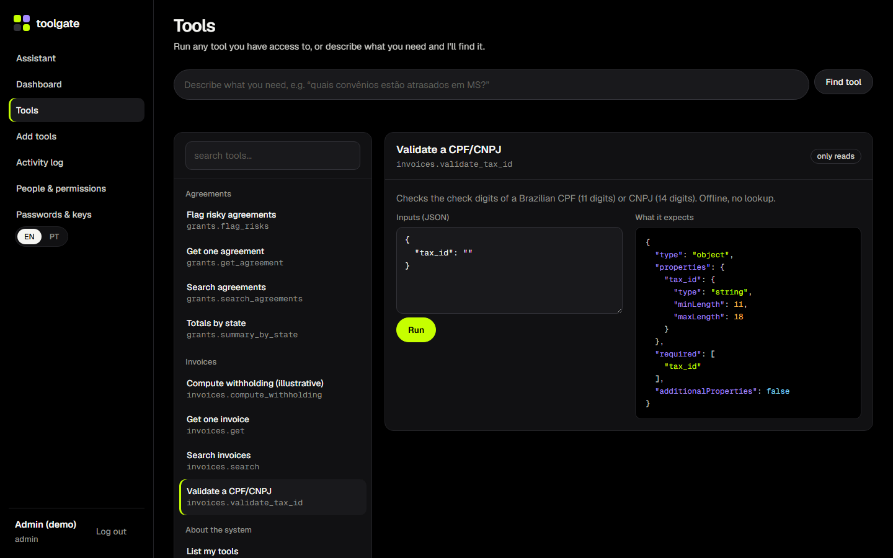
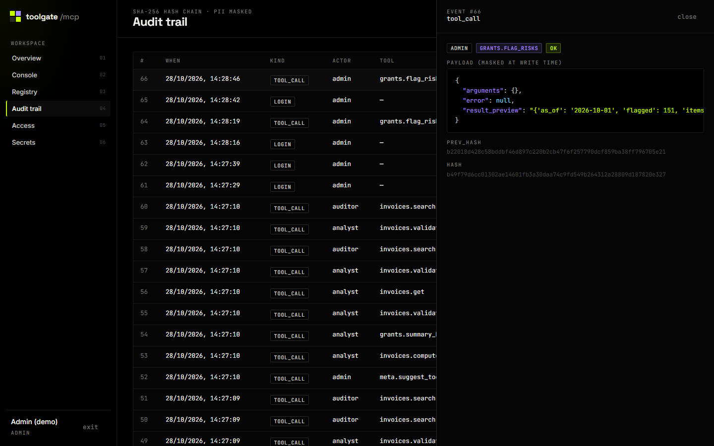
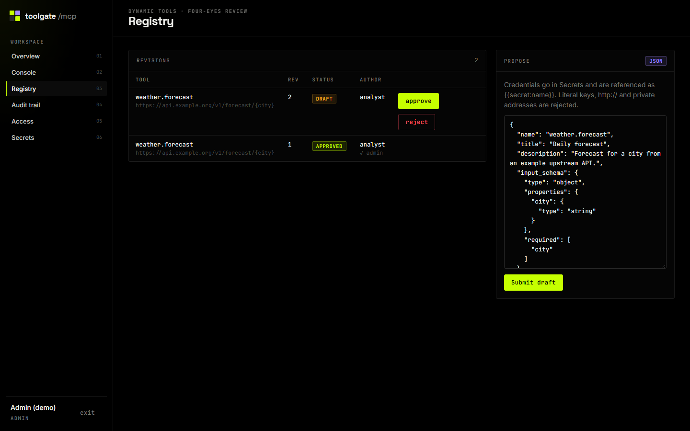
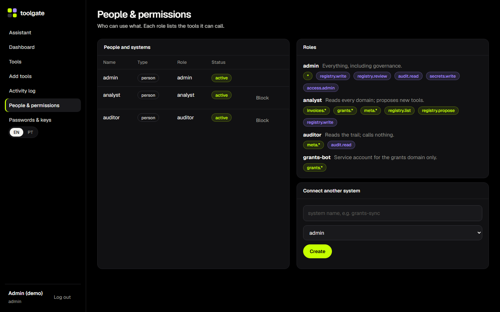

<div align="center">

# toolgate · mcp-tool-gateway

**Um único servidor MCP governado na frente de vários domínios de tools.**
Permissão por tool · secrets criptografados · tools dinâmicas com revisão a quatro olhos · trilha de auditoria à prova de adulteração.


[English](README.md) · **Português**



</div>

---

## Por que existe

Dar tools a um LLM é fácil. O trabalho de verdade é dar **com segurança, entre
equipes, e conseguir responder "quem chamou o quê, com quais dados, e era
permitido?"**. Este repositório é essa camada: um único servidor MCP ao qual
todo cliente se conecta, onde toda chamada (do Claude Desktop, do painel web ou
de outro backend) passa pela mesma porta.

> Todos os dados são sintéticos, gerados com sementes fixas. Nada aqui precisa
> de chave de API para rodar, e nenhuma chave está no repositório.

## O que demonstra

| Capacidade | Como |
|---|---|
| **Servidor MCP com tools vindas de dados** | `mcp.server.lowlevel.Server` de baixo nível: as tools e seus JSON Schemas saem do catálogo a cada requisição, então uma tool aprovada no painel aparece no próximo `tools/list` do cliente, sem reiniciar. |
| **Um executor para todas as portas** | `resolver → autorizar → limitar taxa → validar → executar → auditar`, o mesmo para MCP via stdio, painel e API de serviço ([ADR 0001](docs/adr/0001-one-executor-for-every-door.md)). |
| **Permissão por tool** | Papéis são dados: globs fnmatch sobre nomes de tools + um conjunto fechado de permissões administrativas. O cliente só *vê* as tools que pode chamar ([ADR 0003](docs/adr/0003-roles-as-data.md)). |
| **Tools dinâmicas governadas** | Endpoints HTTP cadastrados como JSON, validados (schema, https, sem IP privado, sem credencial literal) e aprovados por **outra** pessoa ([ADR 0004](docs/adr/0004-dynamic-tools-with-four-eyes.md)). |
| **Secrets do jeito certo** | Fernet em repouso, referências `{{secret:nome}}` resolvidas por quem chama no momento da chamada, nunca exibidas de volta. |
| **Auditoria à prova de adulteração** | Cadeia de hashes SHA-256 sobre eventos já mascarados; o painel verifica ao vivo ([ADR 0005](docs/adr/0005-hash-chained-audit.md)). Cada id de correlação abre a requisição inteira na trilha. |
| **Mascaramento de dados pessoais** | CPF, CNPJ, e-mail, telefone, cartão e tokens mascarados *antes* de gravar, mantendo o final suficiente para o suporte. |
| **Chat sobre as tools governadas** | `/api/chat` leva uma mensagem em PT ou EN até a tool certa, extrai os argumentos, pergunta o que falta, mantém o contexto (“e em GO?”), executa pelo mesmo executor (permissão + auditoria) e explica o resultado. Funciona offline por padrão; com `GATEWAY_LLM_API_KEY` passa a usar tool calling compatível com OpenAI sobre as mesmas tools. |
| **Conversas armazenadas** | Cada conversa fica salva por usuário (SQLite), com as chamadas, resultados e ids de correlação; dá para reabrir, renomear ou excluir pela barra lateral e responder uma pergunta pendente dias depois. Isolada por dono: o id da conversa de outra pessoa responde 404. |
| **Baseline determinístico de intenção** | `meta.suggest_tool` ordena as tools para um pedido em PT/EN, com as razões. É o piso contra o qual os roteadores com LLM são medidos no [`llm-routing-eval-lab`](https://github.com/murilo-bassan/llm-routing-eval-lab) ([ADR 0006](docs/adr/0006-deterministic-intent-baseline.md)). |
| **Cuidados de produção** | Proteção contra CSRF, CSP estrita, scrypt, rate limiting, imagem Docker sem root com healthcheck, CI em matriz + smoke test do container. |

## Arquitetura



## Como rodar

```bash
git clone https://github.com/murilo-bassan/mcp-tool-gateway.git
cd mcp-tool-gateway
pip install -r requirements-dev.txt

python -m pytest                      # 102 testes, ~20 s, inclui uma ida e volta MCP real via stdio
python scripts/demo_traffic.py        # opcional: gera atividade para o painel
python -m uvicorn web.app:app --port 8600   # painel → http://localhost:8600 (admin/admin)
```

Usuários de demonstração: `admin/admin`, `analyst/analyst`, `auditor/auditor`. A interface tem opção PT-BR/EN.

Falando MCP pelo terminal, pelo protocolo de verdade:

```bash
python scripts/mcp_call.py list
python scripts/mcp_call.py call invoices.validate_tax_id '{"tax_id": "11.222.333/0001-81"}'
python scripts/mcp_call.py suggest "quais convênios estão atrasados em MS?"
```

Ou conecte ao Claude Desktop com [`docs/claude_desktop_config.example.json`](docs/claude_desktop_config.example.json).
Docker: `docker compose up --build`.

## Domínios de tools (sintéticos)

| Domínio | Tools | Observações |
|---|---|---|
| `invoices.*` | `validate_tax_id`, `search`, `get`, `compute_withholding` | Algoritmos reais de dígito verificador de CPF/CNPJ; tabela de retenção ilustrativa (não é orientação fiscal) com explicação linha a linha. |
| `grants.*` | `search_agreements`, `get_agreement`, `summary_by_state`, `flag_risks` | 240 convênios de transferência sintéticos; regras de risco determinísticas. |
| `meta.*` | `whoami`, `list_tools`, `suggest_tool` | Descoberta, filtrada pelo papel. |
| `registry.*` | `list`, `propose`, `review` | O fluxo de governança, disponível também via MCP. |

## Telas

| Console | Trilha de auditoria |
|---|---|
|  |  |
| **Registro** | **Acesso** |
|  |  |

## Estrutura

```
gateway/
  config.py        configurações via env, trocáveis nos testes
  store.py         SQLite (WAL), schema, transações
  access.py        usuários e serviços, papéis, sessões, chaves de API, scrypt
  secrets_store.py secrets Fernet + resolução de {{secret:x}}
  catalog.py       ToolSpec, @native, busca (nativas + dinâmicas)
  registry.py      ciclo de vida das tools dinâmicas, validação, execução HTTP
  executor.py      a porta única
  audit.py         cadeia de hashes, busca, estatísticas
  masking.py       mascaramento de dados pessoais e credenciais
  intents.py       sugestão determinística de tool
  chat.py          chat determinístico (e com LLM, opcional) sobre o executor
  conversations.py conversas armazenadas por dono
  ratelimit.py     janela deslizante
  domains/         invoices, grants, meta, governança, dados sintéticos
server.py          servidor MCP via stdio
web/               painel FastAPI + interface em JS puro (tema VOID)
scripts/           mcp_call.py (cliente MCP), demo_traffic.py
docs/              ADRs, modelo de segurança, capturas de tela
```

Veja [`docs/security.md`](docs/security.md) para o modelo de ameaças e o que ficou fora de escopo de propósito (em inglês).

---

<sub>Parte de um portfólio de engenharia de IA: veja [ai-engineering-portfolio](https://github.com/murilo-bassan/ai-engineering-portfolio). Licença MIT.</sub>
